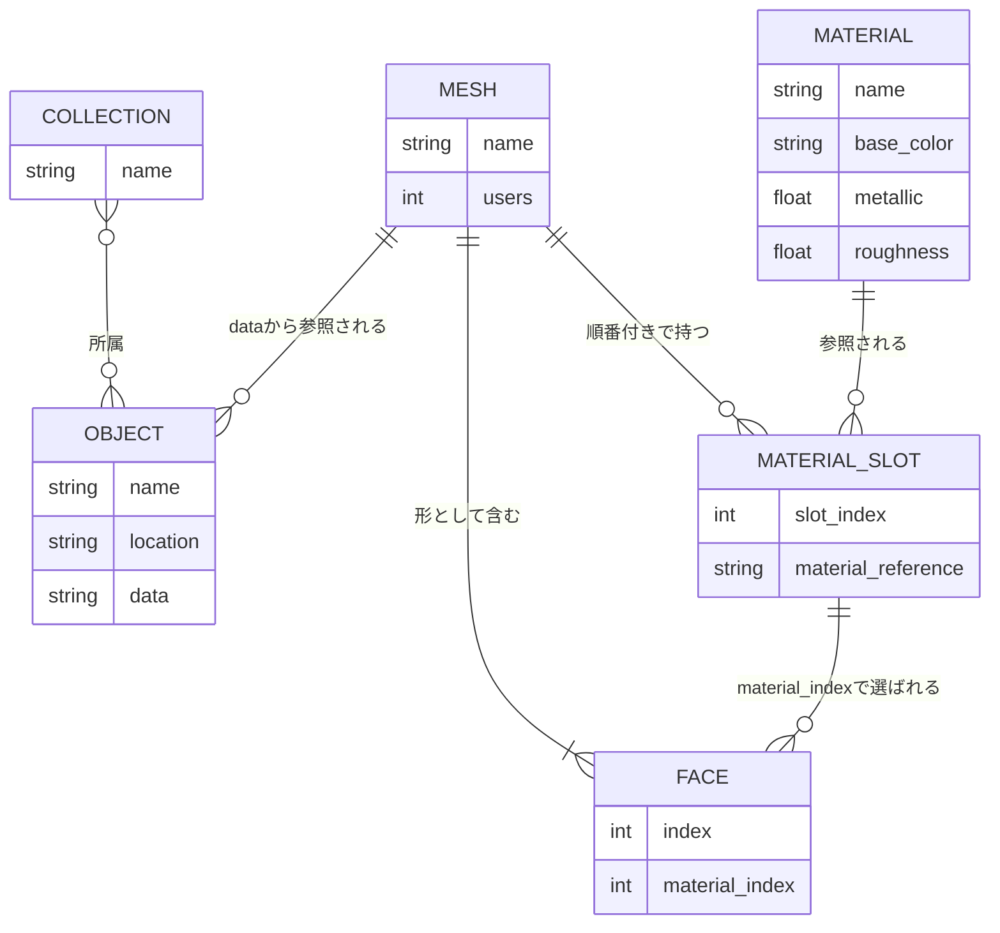

# Rails風ER図で理解するObject・Mesh・Face・Material Slot・Material

## 最初に結論

レッスン06の範囲では、次の理解でよい。

- **Mesh**は、複数のFaceと、順番付きのMaterial Slotを持つ。
- **Material Slot**は、1つのMaterialデータブロックを参照する枠。
- **Face**はMaterialを直接参照しない。`material_index`という整数で、同じMeshの何番目のslotを使うか指定する。
- **Object**はMeshを参照し、LocationなどのTransformを持つ。

最重要の参照経路はこれ。

```text
Face
└── material_index = 1
    └── Mesh.material_slots[1]
        └── Material.Metal
```

## 全体のER図

これはBlenderのデータ関係をRails風に読むための**概念図**。Blender内部にActive Recordのテーブルや主キーがあるという意味ではない。

この図はレッスン06と同じ、Mesh ObjectがMesh側のMaterial slotを使う場合に絞っている。CameraやLightなどMeshを持たないObjectと、ObjectごとにMaterialを差し替える高度な設定は省略する。



`MATERIAL_SLOT`は関係を理解するために中間テーブル風に描いている。実際のPython APIでは、Meshの`materials`という順番付きコレクションへMaterialの参照が並ぶ。

## Rails風の疑似モデル

```ruby
class Collection
  has_and_belongs_to_many :objects
end

class Object
  belongs_to :mesh, foreign_key: :data

  # Location、Rotation、ScaleはObject側
end

class Mesh
  has_many :objects
  has_many :faces
  has_many :material_slots, -> { order(:slot_index) }
  has_many :materials, through: :material_slots
end

class MaterialSlot
  belongs_to :mesh
  belongs_to :material

  # slot_indexは0、1、2……の順番
end

class Face
  belongs_to :mesh

  # 実際に持つのはmaterial_slot_idではなくmaterial_index
  def material_slot
    mesh.material_slots[material_index]
  end

  def material
    material_slot.material
  end
end

class Material
  has_many :material_slots
  has_many :meshes, through: :material_slots
end
```

Railsとの最大の違いは、`Face belongs_to :material_slot`に相当する部分が外部キーではないこと。Faceは`material_slot_id`を持たず、**同じMesh内の配列番号**である`material_index`を持つ。

## レッスン06をテーブル風に見る

### Object

| Object | `data`で参照するMesh | Location |
|---|---|---|
| `Sample.MaterialSlots` | `Sample.MaterialSlots.Mesh` | `(0, 0, 0)` |

### MeshのMaterial Slot

| slot番号 | 参照するMaterial |
|---:|---|
| `0` | `Material.Wood` |
| `1` | `Material.Metal` |

### MeshのFace

| Face番号 | 教材内の呼び名 | `material_index` | 結果として使うMaterial |
|---:|---|---:|---|
| `0` | Bottom | `1` | `Mesh.materials[1]` → `Material.Metal` |
| `1` | Top | `1` | `Mesh.materials[1]` → `Material.Metal` |
| `2` | Front | `0` | `Mesh.materials[0]` → `Material.Wood` |
| `3` | Right | `0` | `Mesh.materials[0]` → `Material.Wood` |
| `4` | Back | `0` | `Mesh.materials[0]` → `Material.Wood` |
| `5` | Left | `0` | `Mesh.materials[0]` → `Material.Wood` |

ここでは3種類の番号を区別する。

| 番号 | 意味 |
|---|---|
| `Face.index` | Mesh内で何番目のFaceか |
| `slot_index` | MeshのMaterial一覧で何番目の枠か |
| `Face.material_index` | そのFaceが何番目のslotを使うか |

`Face.index = 5`でも`material_index = 0`になり得る。この場合は「6番目のFaceが、最初のMaterial slotを使う」という意味。

## Pythonで参照をたどる

レッスン06のTop Faceは`Face.index == 1`。

```python
sample_object = bpy.data.objects["Sample.MaterialSlots"]
sample_mesh = sample_object.data

top_face = sample_mesh.polygons[1]
slot_index = top_face.material_index
top_material = sample_mesh.materials[slot_index]

print(slot_index)        # 1
print(top_material.name) # Material.Metal
```

1行で書けば次の参照になる。

```python
sample_object.data.materials[
    sample_object.data.polygons[1].material_index
]
```

ただし教材コードでは、Object、Mesh、Face、Materialのどれを扱っているか読みやすくするため、途中の変数へ分ける。

## Blender画面の操作は何を読み書きする？

Material Propertiesで操作したときの意味は次のとおり。

| 画面操作 | データ上の意味 |
|---|---|
| Material slotの行をクリック | 操作対象にするslotを選ぶ。Faceの値はまだ変わらない。 |
| **Select** | `material_index`が現在のslot番号と同じFaceを選択する。データを探して表示する操作。 |
| **Deselect** | 現在のslot番号を使っているFaceを選択解除する。Material割り当ては変わらない。 |
| **Assign** | 選択中Faceの`material_index`へ、現在のslot番号を書き込む。 |

たとえばTop Faceを選び、`Material.Wood`のslotを選んで**Assign**すると、次の1か所だけが変わる。

```text
変更前: Top.material_index = 1 → Material.Metal
変更後: Top.material_index = 0 → Material.Wood
```

Material自体のBase ColorやMetallicを変更したのではなく、Top Faceが参照するslot番号を変えたということ。

## 共有すると何が一緒に変わる？

```text
Materialの設定を変更
└── そのMaterialを参照するすべてのslotで見た目が変わる

Meshのslot構成やFace.material_indexを変更
└── そのMeshを共有するすべてのObjectで割り当てが変わる

Object.locationを変更
└── そのObjectだけが移動する
```

Object、Mesh、Materialはいずれも別のデータブロック。どのデータを変更したかによって、影響範囲が変わる。

BlenderにはMaterial slotの参照元をObject側にする設定もある。その場合は同じMeshを共有しながらObjectごとに別Materialを使えるが、このレッスンでは扱わない。まずは`sample_mesh.materials.append(...)`で作ったMesh側のslotだけを理解する。

## 関連レッスン

- [01 共有Mesh](../../lessons/01_shared_mesh/README.md)：複数Objectが同じMeshを参照する関係
- [03 Collection](../../lessons/03_collection/README.md)：CollectionとObjectの所属関係
- [05 マテリアルの入口](../../lessons/05_material_basics/README.md)：MaterialとPrincipled BSDF
- [06 Material Slot](../../lessons/06_material_slots/README.md)：Faceごとにslotを使い分ける操作
